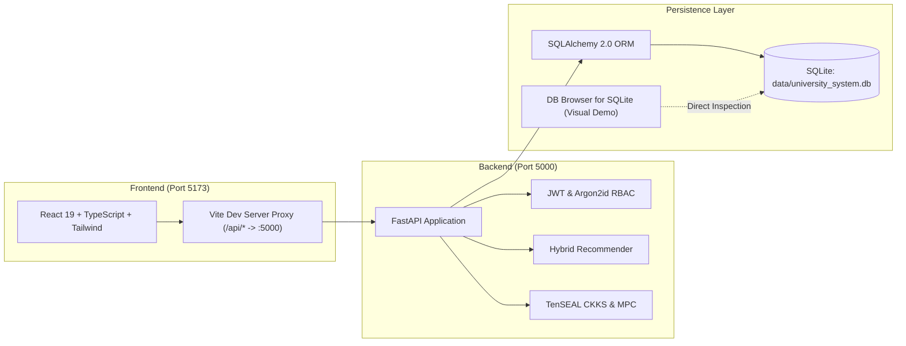

# Secure Resource Recommendation System for University Communities
**Category:** Community SDG | **Primary Alignment:** UN Sustainable Development Goal 4: Quality Education  
**Architecture:** FastAPI (Python 3.12) + SQLite / SQLAlchemy + React 19 / TypeScript / Vite / Tailwind CSS  
**Cryptographic Primitives:** Homomorphic Encryption (TenSEAL CKKS 128-bit) + 3-Party Semi-Honest Beaver Triple MPC

---

## 1. Executive Summary & Project Abstract

Modern university campuses host thousands of academic resources, research papers, departmental colloquia, and support services. However, students frequently miss relevant opportunities due to information fragmentation, while concerns regarding privacy, data leakage, and unauthorized tracking prevent institutional platforms from adopting conventional cloud recommendation systems.

The **Secure Resource Recommendation System for University Communities** is a privacy-preserving recommendation and campus discovery platform designed to resolve this tension. Built on an approved technology stack of **Python, FastAPI, SQLite (SQLAlchemy 2.0), and React 19**, the system combines:

1. **Machine Learning Recommendation Engine**: A hybrid architecture integrating **Neural Matrix Factorization (NeuMF)** with content-based departmental affinity and keyword similarity.
2. **Cryptographic Privacy Preservation**: Post-quantum **Homomorphic Encryption (TenSEAL CKKS 128-bit)** for oblivious dot-product evaluation and **3-Party Semi-Honest Secure Multi-Party Computation (MPC)** using additive secret sharing with Beaver Triples.
3. **Defense-in-Depth Security**: Argon2id password hashing ($m=65536, t=3, p=4$), short-lived JWT access tokens with active revocation (`token_version`), backend-enforced Role-Based Access Control (RBAC), and append-only tamper-resistant administrative audit logging.
4. **Visual Database Demonstration**: Full database storage in **SQLite (`data/university_system.db`)**, allowing teachers and evaluators to visually inspect tables, rows, and relationships using **DB Browser for SQLite**.
5. **Modern Frontend Experience**: A clean single-page app built with React 19, TypeScript, Vite, and Tailwind CSS featuring instant one-click login for four university personas (**Student**, **Faculty**, **Staff**, and **Admin**).

---

## 2. System Architecture



---

## 3. Quick Start Guide

### Prerequisites
- Python 3.10+ (Python 3.12 recommended)
- Node.js 18+ and `pnpm` (or `npm`)
- [DB Browser for SQLite](https://sqlitebrowser.org/) (optional, for visual inspection)

### Step 1: Start the FastAPI Backend
```powershell
cd backend
# Create virtual environment if needed: python -m venv venv
.\venv\Scripts\python.exe -m pip install -r requirements.txt
.\venv\Scripts\python.exe run.py
```
*Backend runs on: `http://127.0.0.1:5000`*  
*Interactive Swagger API Docs: `http://127.0.0.1:5000/docs`*

### Step 2: Start the React Frontend
```powershell
cd frontend
pnpm install
pnpm run dev
```
*Frontend runs on: `http://localhost:5173`*

---

## 4. Four Pre-Seeded Demonstration Personas

The application automatically seeds the database on startup with four distinct user personas:

| Role | Persona Email | Default Password | Features Demonstrated |
| :--- | :--- | :--- | :--- |
| **Student** | `student.test@university.edu` | `DemoPassword2026!` | Personalized recommendations, catalog search, bookmarks, privacy consent toggles. |
| **Faculty** | `faculty.lead@university.edu` | `DemoPassword2026!` | Authoring academic resources, publishing research notes, scheduling symposiums. |
| **Staff** | `campus.staff@university.edu` | `DemoPassword2026!` | Managing student support services, counseling hours, tutoring labs. |
| **Admin** | `root.admin@university.edu` | `DemoPassword2026!` | Security audit center, cryptographic operation logs, system aggregate metrics. |

*Note: On the login page, you can click any of the 4 demo buttons to automatically populate credentials!*

---

## 5. Visual Database Demonstration with DB Browser for SQLite

1. Open **DB Browser for SQLite**.
2. Click **Open Database** and choose:
   `c:\Users\raoak\Desktop\antigravity\community\data\university_system.db`
3. Click the **Browse Data** tab to view any of the 9 system tables:
   - `users`: User accounts, departments, and Argon2id password hashes.
   - `resources`: Academic textbooks, papers, and lab manuals.
   - `events`: Campus symposiums, hackathons, and lectures.
   - `services`: Academic and wellness support services.
   - `bookmarks`: Student-saved academic materials.
   - `recommendation_feedback`: Student ratings and click feedback.
   - `privacy_preferences`: Student differential privacy and homomorphic encryption settings.
   - `privacy_operations`: Real-time cryptographic operations audit log.
   - `audit_logs`: Security and access logs.
4. Execute pre-written queries from `data/demo_queries.sql` in the **Execute SQL** tab.

---

## 6. Running Automated Tests

Run the complete end-to-end integration test suite using Pytest:

```powershell
cd backend
.\venv\Scripts\pytest.exe tests/test_fastapi_e2e.py -v
```

All 6 integration tests will execute and pass:
- `test_health_check`
- `test_auth_demo_login_and_me`
- `test_catalog_endpoints`
- `test_recommendations_and_feedback`
- `test_privacy_and_cryptography`
- `test_admin_control_center`

---

## 7. Additional Presentation Documentation

- **Comprehensive Viva & Technical Guide:** [PROJECT_TECHNICAL_PRESENTATION_GUIDE.md](file:///c:/Users/raoak/Desktop/antigravity/community/PROJECT_TECHNICAL_PRESENTATION_GUIDE.md) (Sections A through Q, including 30+ viva Q&As and 5-7 min presentation script)
- **Live Demo Playbook:** [LIVE_PROJECT_DEMONSTRATION.md](file:///c:/Users/raoak/Desktop/antigravity/community/LIVE_PROJECT_DEMONSTRATION.md) (Step-by-step presentation script)
- **QA & Implementation Status:** [PROJECT_IMPLEMENTATION_STATUS.md](file:///c:/Users/raoak/Desktop/antigravity/community/PROJECT_IMPLEMENTATION_STATUS.md) (Audit matrix with verified labels)
- **Demo SQL Queries:** [data/demo_queries.sql](file:///c:/Users/raoak/Desktop/antigravity/community/data/demo_queries.sql) (Ready-to-run queries for DB Browser)
