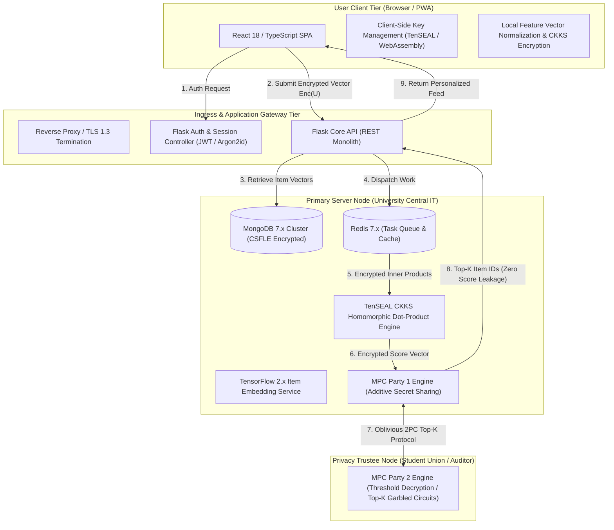

# Technical Architecture Blueprint: Secure Resource Recommendation System for University Communities

**Team Name:** SHTKS (26O2227)  
**Project Category:** Community SDG  
**Document Version:** 1.0.0 (Phase 1 — Architecture & Engineering Specification)  
**Architectural Scope:** Complete System Blueprint (No implementation code until Phase 1 approval)

---

## Executive Summary & System Philosophy

The **Secure Resource Recommendation System for University Communities** addresses a fundamental tension in modern higher education: university stakeholders (students, faculty, and administrative staff) require contextual, highly personalized recommendations for critical academic resources, events, and campus services, yet the underlying profile data—such as psychological counseling inquiries, academic probation recovery programs, emergency financial aid, and minority-advocacy student groups—constitutes highly sensitive personal data.

To resolve this trade-off between hyper-personalization and absolute privacy, this architecture integrates **Homomorphic Encryption (HE)** and **Secure Multi-Party Computation (MPC)** directly into a **TensorFlow 2.x** candidate-scoring pipeline, backed by **Flask** and **MongoDB**. The resulting platform guarantees that neither cloud database administrators, institutional service providers, nor malicious network eavesdroppers can inspect raw user preference vectors, search patterns, or un-consented interaction logs.



---

## 1. Product Understanding and Scope

### 1.1 The Core Problem
University ecosystems generate massive volumes of academic resources (research grants, peer tutoring, academic writing centers), campus events (career fairs, cultural symposia, hackathons), and student support services (confidential mental health counseling, accessibility accommodations, financial hardship stipends).

Standard recommendation systems (e.g., collaborative filtering, standard matrix factorization) require centralized ingestion of plaintext user interaction logs. In a university environment:
1. **Regulatory & Institutional Exposure:** Plaintext storage of sensitive service usage violates institutional compliance policies (e.g., FERPA in the US, GDPR in Europe, and national data privacy acts).
2. **The "Chilling Effect":** Students avoid seeking mental health resources or academic probation workshops if they fear digital footprints could leak to professors, prospective campus employers, or peers.
3. **Internal Threat Model:** Privileged database administrators and compromised IT systems have historically been vectors for internal data breaches.

### 1.2 In-Scope Deliverables
- **Unified Discovery Engine:** Personalized recommendations across three specific silos:
  1. *Academic Resources:* Course study materials, open-access research repositories, departmental tutoring.
  2. *University Events:* Workshops, guest lectures, hackathons, job fairs, campus life events.
  3. *University Services:* Confidential counseling, career guidance, disability services, financial advisory.
- **Client-Controlled Privacy:** Local generation of cryptographic keys; raw preference profiles never leave the client boundary in cleartext.
- **Privacy-Preserving Scoring:** Execution of candidate scoring directly over encrypted vectors using the CKKS homomorphic scheme.
- **Oblivious Ranking:** Multi-party computation to derive the Top-$K$ items without exposing non-recommended item scores to the central server.
- **Transparency & Education Center:** A dedicated Privacy Center and real-time interactive Privacy Engine Visualization demystifying the mathematical transformation of user data.

### 1.3 Out-of-Scope (Explicit Non-Goals)
- Centralized surveillance, grade prediction, or automated disciplinary monitoring.
- Integration with external commercial advertising networks.
- Full fully homomorphic evaluation of deep non-linear neural networks on-server (which would introduce 30+ second latencies; non-linear candidate retrieval is handled offline or decoupled).

---

## 2. Functional Requirements

### 2.1 Public Website & Educational Portal
- **FR-PUB-01:** High-performance, cinematic landing page introducing the platform, the research mission, and the UN Sustainable Development Goals (SDG 4: Quality Education, SDG 9: Industry, Innovation, and Infrastructure, SDG 16: Peace, Justice, and Strong Institutions).
- **FR-PUB-02:** Interactive "Privacy Playground" explaining encryption steps with simulated mathematical transformations (client-side mock vs. production pipeline).
- **FR-PUB-03:** Transparent system documentation detailing threat models and data lifecycle.

### 2.2 Authentication & Identity Governance
- **FR-AUTH-01:** University email verification domain validation (`@*.edu` / `@*.ac.*`).
- **FR-AUTH-02:** Secure credential handling with Argon2id password hashing.
- **FR-AUTH-03:** Stateless, short-lived JWTs (15 min expiry) paired with HttpOnly, SameSite=Strict refresh tokens stored in Redis.
- **FR-AUTH-04:** Strict Role-Based Access Control (RBAC) supporting four distinct institutional roles.

### 2.3 User Dashboard & Discovery
- **FR-DASH-01:** Multi-faceted feed displaying Academic Resources, Events, and Services.
- **FR-DASH-02:** Search and multi-attribute filtering (category, date, department, accessibility tag).
- **FR-DASH-03:** Local preference tuning: sliders for topic interests, service needs, and event types that generate client-side preference vectors.
- **FR-DASH-04:** Bookmark, save, and history logs stored locally or encrypted server-side.

### 2.4 Privacy Center & Data Autonomy
- **FR-PRIV-01:** Explicit consent toggles for data categories (e.g., "Allow Academic History to influence Service Recommendations: Yes/No").
- **FR-PRIV-02:** One-click cryptographic key re-generation (invalidating past ciphertext representations).
- **FR-PRIV-03:** GDPR-aligned "Right to be Forgotten" executing hard cascade deletes of user credentials and orphaned encrypted preference records.
- **FR-PRIV-04:** Privacy audit log showing every instance an encrypted vector was queried by the recommendation engine.

### 2.5 Admin & Institutional Resource Management
- **FR-ADM-01:** Resource publishing workflow for verified faculty and university staff.
- **FR-ADM-02:** Moderation queue for community-submitted events.
- **FR-ADM-03:** System health dashboard tracking latency, ciphertext payload sizes, and MPC node health.
- **FR-ADM-04:** Anonymized, aggregated platform metrics (e.g., total recommendations served per category) using differential privacy thresholds ($k$-anonymity $\ge 15$).

---

## 3. Non-Functional Requirements

### 3.1 Latency & Performance SLA
- **NFR-PERF-01 (API Response Time):** Standard read/write endpoints $\le 120\text{ ms}$ (p95).
- **NFR-PERF-02 (Encrypted Inference Latency):** Homomorphic vector dot product for a candidate pool of $M = 500$ resources $\le 450\text{ ms}$ on standard multi-core x86_64 CPU.
- **NFR-PERF-03 (MPC Top-$K$ Selection):** 2-Party oblivious argmax over $M = 500$ candidate scores $\le 350\text{ ms}$.
- **NFR-PERF-04 (Total Recommendation Turnaround):** End-to-end user request-to-render $\le 1.2\text{ seconds}$ under nominal network conditions.

### 3.2 Security, Cryptography & Privacy
- **NFR-SEC-01 (Security Level):** 128-bit classical cryptographic security level minimum for all HE parameters (matching NIST SP 800-57 guidelines).
- **NFR-SEC-02 (Transport Security):** Strict TLS 1.3 with Perfect Forward Secrecy (PFS), HSTS enabled with 1-year max-age.
- **NFR-SEC-03 (Database Security):** MongoDB Client-Side Field-Level Encryption (CSFLE) for sensitive profile fields; storage at rest encrypted via AES-256-XTS.
- **NFR-SEC-04 (Zero Cleartext Leakage):** The central Flask backend server shall at no point log, cache, or persist unencrypted user preference vectors.

### 3.3 Scalability & Reliability
- **NFR-SCAL-01 (Concurrency):** Modular monolith designed to handle $\ge 500$ concurrent active recommendation sessions using asynchronous worker pools.
- **NFR-SCAL-02 (High Availability):** Target 99.5% uptime during academic operating semesters.

### 3.4 Accessibility & UI Standards
- **NFR-UI-01:** Full compliance with WCAG 2.1 AA accessibility guidelines (contrast ratios $\ge 4.5:1$, screen-reader navigable, keyboard navigable).
- **NFR-UI-02:** Zero layout shift (Cumulative Layout Shift $< 0.05$), First Contentful Paint $< 1.0\text{ s}$ for landing page.

---

## 4. User Roles and Permissions

The system enforces a strict Role-Based Access Control (RBAC) matrix augmented with Attribute-Based Access Control (ABAC) for sensitive resources.

| Role | Role Description | Academic Resources | University Events | University Services | User Profiles & Settings | Encrypted Vector Engine | Audit & Admin Dashboards |
| :--- | :--- | :--- | :--- | :--- | :--- | :--- | :--- |
| **Student** | Primary consumer of recommendations and campus services | Read, Bookmark, Rate | Read, Register, Rate | Read, Request, Confidential Booking | Own Profile Read/Write | Submit $\text{Enc}(U)$, Trigger Inference | Denied |
| **Faculty** | Academic personnel, research advisors, course instructors | Read, Create, Edit (Own Department) | Read, Create Academic Events | Read general services | Own Profile Read/Write | Submit $\text{Enc}(U)$, Trigger Inference | Departmental View Only |
| **Staff** | Administrative service providers (Health, Counseling, Financial Aid) | Read | Read, Create Campus-wide Events | Read, Create, Manage Services & Bookings | Own Profile Read/Write | Denied | Service Management Console Only |
| **Admin** | University IT & Compliance Officers | Full Admin / Moderate | Full Admin / Moderate | Full Admin / Moderate | Manage Accounts, Enforce Deletions | Manage Node Keys, Monitor Health | Full System Audit Logs, MPC Status |

### Context-Aware Access Control (ABAC) Rules
1. **Rule 1 (Confidential Services):** When a resource is flagged `is_sensitive: true` (e.g., "Addiction Recovery Support", "Emergency Housing Grant"), its metadata can only be indexed into the general item pool in vectorized format. In cleartext browsing, it is obfuscated unless matched by encrypted query.
2. **Rule 2 (Audit Isolation):** System Administrators can inspect transaction counts and latency telemetry, but can *never* query or inspect the contents of the `encrypted_preferences` collection or correlate User IDs with Specific Item Recommendations.

---

## 5. Complete System Architecture

### 5.1 Architectural Paradigm: Asynchronous Modular Monolith
To prevent the operational failure modes and network hop latency of microservices in a university project, the backend is architected as an **Asynchronous Modular Monolith** in Python/Flask, decoupled into strict domain boundaries with internal event pub/sub (Redis):

```
                   +------------------------------------------------+
                   |                 Client Browser                 |
                   |   (React 18 / Zustand / WebAssembly TenSEAL)    |
                   +-----------------------+------------------------+
                                           | HTTPS / WSS
                                           v
                   +------------------------------------------------+
                   |               Nginx Reverse Proxy              |
                   |      (SSL Termination, Rate Limiting, CSP)     |
                   +-----------------------+------------------------+
                                           |
                                           v
                   +------------------------------------------------+
                   |         Flask Application Core Monolith        |
                   |                                                |
                   |  [ Auth Module ]       [ Resource Catalog ]    |
                   |  [ Privacy Center ]    [ Admin Governance ]    |
                   |  [ Recommendation Controller Layer ]           |
                   +-----------+------------------------+-----------+
                               |                        |
             Async Task Queue  v                        v Database Queries
                   +-----------------------+  +---------------------+
                   |     Redis 7.x Queue   |  |   MongoDB 7.x Core  |
                   | (Tasks, Session Store)|  | (Encrypted Records, |
                   +-----------+-----------+  |  Catalogs, Audits)  |
                               |              +---------------------+
                               v
            +-------------------------------------+
            |      Cryptographic Worker Pool      |
            |                                     |
            |   [ TenSEAL CKKS Evaluator Engine ] |
            |   [ TensorFlow Item Vector Store  ] |
            |   [ MPC Party 1 Engine (Central)  ] |
            +------------------+------------------+
                               | 
                               | mTLS 2PC Protocol
                               v
            +-------------------------------------+
            |    Privacy Trustee Server (Node 2)  |
            |     [ MPC Party 2 Engine (Trustee)] |
            +-------------------------------------+
```

### 5.2 Architectural Domain Modules & Boundaries
1. **Identity & Authorization Domain:** Manages user lifecycles, authentication credentials, and token issuance.
2. **Resource Catalog Domain:** Manages CRUD operations, categorization, tagging, and indexing of academic assets, events, and services.
3. **AI/ML Vector Pipeline Domain:** Employs TensorFlow 2.x to generate dense latent vector embeddings for items offline or on content update.
4. **Cryptographic Processing Domain:** Houses the TenSEAL CKKS vector computation routines and MPC socket listeners.
5. **Privacy & Governance Domain:** Coordinates consent graphs, right-to-be-forgotten cascades, and immutable audit trails.

---

## 6. Frontend Architecture & Design System

### 6.1 Recommended Technology Stack (Requiring Mentor Approval)
- **Framework:** React 18+ with TypeScript (Strict mode).
- **Build Tool:** Vite (high performance, minimal build overhead).
- **Styling:** Tailwind CSS with custom CSS variables for strict design token control.
- **State Management:** 
  - `TanStack Query (React Query)`: Server state caching, optimistic updates, automatic refetching.
  - `Zustand`: Ephemeral client state (auth tokens, local preference slider state, privacy consent state).
- **Motion & 3D Experiences:**
  - `Three.js` / `@react-three/fiber`: Restricted strictly to the Public Landing Page hero visualizer and the Privacy Engine interactive demonstration.
  - `GSAP` + `ScrollTrigger`: Cinematic landing page narrative scroll.
  - `Framer Motion`: In-app layout transitions, modal reveals, and dashboard micro-interactions.

### 6.2 Visual Direction & Design Tokens
The visual design language embodies a "Sovereign Academic" aesthetic—clean, deeply technical, calm, and trustworthy:
- **Color Palette:**
  - Background Base: `#0B0F17` (Deep Obsidian Void).
  - Surface Elevated: `#111827` (Card Surface) with `#1F2937` borders.
  - Accent Sovereign: `#6366F1` (Indigo Glow) and `#06B6D4` (Cyan Privacy Shield).
  - Functional Accents: `#10B981` (Cryptographically Verified), `#F59E0B` (Pending Consent).
  - Text Primary: `#F9FAFB` (High Contrast White), Text Secondary: `#9CA3AF` (Muted Slate).
- **Typography:**
  - Display / Headings: `Plus Jakarta Sans` or `Cabinet Grotesk` (Modern, geometric, authoritative).
  - Body / UI: `Inter` (Optimized for micro-reading and high legibility).
  - Monospace / Cryptographic Hashes: `JetBrains Mono`.

```
+-----------------------------------------------------------------------------------------+
| [SHTKS Sovereign]   Academic Discovery   Events   Services   Privacy Center   [Profile] |
+-----------------------------------------------------------------------------------------+
|  +-----------------------------------------------------------------------------------+  |
|  | [SHIELD ACTIVE: CKKS-128b]  Your Preferences are Encrypted Locally                |  |
|  +-----------------------------------------------------------------------------------+  |
|                                                                                         |
|  Recommended For You (Zero-Knowledge Computed)                Filters: [All] [Academic] |
|  +---------------------------+ +---------------------------+ +------------------------+ |
|  | Academic Resource         | | Campus Support Service    | | University Event       | |
|  | Quantum Computing Seminars| | Student Financial Hardship| | Fall Hackathon 2026    | |
|  | CS Dept - Hall B          | | Dean of Students Office   | | Innovation Lab         | |
|  | [Match Confidence: High]  | | [100% Confidential]       | | Nov 20, 2:00 PM        | |
|  | [View Details] [Bookmark] | | [Access Confidentiality]  | | [RSVP Anonymously]     | |
|  +---------------------------+ +---------------------------+ +------------------------+ |
+-----------------------------------------------------------------------------------------+
```

### 6.3 Performance Optimization Protocol
- Three.js WebGL canvases are unmounted dynamically when the user leaves the landing/educational pages to free GPU contexts and guarantee smooth 60fps performance inside the authenticated application.
- Dynamic imports (`React.lazy`) for all heavy views: Privacy Visualization Canvas, Admin Analytics, and Account Settings.

---

## 7. Backend Architecture (Flask)

### 7.1 Framework Structure & Application Factory
The Flask application is structured using the Application Factory Pattern (`create_app()`) with blueprint separation:

```
backend/
├── app/
│   ├── __init__.py           # App factory, extension initialization
│   ├── config.py             # Environment configuration (Dev, Test, Prod)
│   ├── extensions.py         # PyMongo, Redis, Celery, CORS instances
│   ├── api/
│   │   ├── __init__.py
│   │   ├── auth/             # Authentication & session endpoints
│   │   ├── resources/        # Academic, Event, Service CRUD & search
│   │   ├── recommendations/  # Vector submission & encrypted inference
│   │   ├── privacy/          # Consent graph, audit trail, deletion
│   │   └── admin/            # Node telemetry, user & catalog management
│   ├── core/
│   │   ├── exceptions.py     # Custom API error handlers
│   │   ├── middleware.py     # Rate limiting, CSP injection, security headers
│   │   └── security.py       # Argon2id, JWT validator, RBAC decorators
│   ├── services/
│   │   ├── catalog_service.py
│   │   ├── embedding_service.py  # TensorFlow model loader & inference
│   │   ├── crypto_service.py     # TenSEAL CKKS wrapper
│   │   └── mpc_service.py        # 2PC socket client
│   └── models/               # Domain dataclasses & MongoDB schemas
├── wsgi.py                   # Production Gunicorn entry point
└── worker.py                 # Celery/Redis asynchronous task entry point
```

### 7.2 Request Lifecycle & Asynchronous Cryptographic Offload
Because homomorphic vector multiplication over hundreds of items requires intensive CPU cycles, handling it synchronously in standard Flask HTTP threads would block Gunicorn workers and degrade overall system throughput.

**Processing Pipeline:**
1. User client POSTs encrypted preference payload $\text{Enc}(U)$ to `/api/v1/recommendations/query`.
2. Flask validates the JWT token, confirms consent status, and pushes an asynchronous evaluation job to the Redis queue.
3. The HTTP endpoint returns an immediate `202 Accepted` with a Job Ticket ID, or upgrades to a WebSocket connection (`/ws/recommendations/<ticket_id>`).
4. A dedicated background worker executes the TenSEAL dot product against pre-warmed item embeddings in RAM.
5. Upon completion, the worker triggers the 2PC Top-$K$ protocol with Node 2, caches the resulting Top-$K$ item IDs in Redis (TTL: 180s), and pushes the result to the client via WebSocket or polling resolution.

---

## 8. Database Design (MongoDB Architecture)

### 8.1 Storage Architecture & Encryption Tiers
Data is partitioned across three distinct security classes:
1. **Tier 1 (Public / Cleartext):** Catalog data (resource titles, public event schedules, service descriptions). Publicly indexable.
2. **Tier 2 (Sensitive / CSFLE Encrypted):** Personally Identifiable Information (PII) including email addresses, student IDs, and audit records. Encrypted at rest using MongoDB Client-Side Field-Level Encryption.
3. **Tier 3 (Zero-Knowledge / Ephemeral):** Encrypted user preference vectors $\text{Enc}(U)$ submitted for inference. These are treated as ephemeral compute payloads; only cryptographic hashes or user-consented encrypted templates are optionally saved.

### 8.2 Detailed Collection Specifications

#### Collection: `users`
```json
{
  "_id": { "$type": "objectId" },
  "university_id": { "$type": "string" },          // CSFLE Encrypted
  "email": { "$type": "string" },                  // Unique, indexed
  "password_hash": { "$type": "string" },          // Argon2id hash
  "role": { "enum": ["student", "faculty", "staff", "admin"] },
  "department": { "$type": "string" },
  "is_verified": { "$type": "bool" },
  "created_at": { "$type": "date" },
  "updated_at": { "$type": "date" }
}
```
*Indexes:*
- `email`: Unique index.
- `university_id`: Hash index.

#### Collection: `resources`
```json
{
  "_id": { "$type": "objectId" },
  "title": { "$type": "string" },
  "description": { "$type": "string" },
  "type": { "enum": ["academic", "event", "service"] },
  "category": { "$type": "string" },
  "tags": [{ "$type": "string" }],
  "provider_department": { "$type": "string" },
  "is_sensitive": { "$type": "bool" },             // If true, metadata is restricted
  "metadata": {
    "location": { "$type": "string" },
    "schedule": { "$type": "string" },
    "contact_email": { "$type": "string" },
    "capacity": { "$type": "int" }
  },
  "embedding_version": { "$type": "string" },      // Tracks TensorFlow model lineage
  "embedding_vector": [{ "$type": "double" }],     // 64-dimensional dense float vector
  "status": { "enum": ["active", "archived", "pending_review"] },
  "created_by": { "$type": "objectId" },
  "created_at": { "$type": "date" }
}
```
*Indexes:*
- `type`, `category`: Compound index.
- `tags`: Multikey index.
- `status`, `is_sensitive`: Filtering compound index.
- Text search index on `title`, `description`, `tags`.

#### Collection: `user_privacy_profiles`
```json
{
  "_id": { "$type": "objectId" },
  "user_id": { "$type": "objectId" },              // Referenced to users._id
  "public_he_key": { "$type": "binData" },         // User's serialized CKKS Public Key
  "relin_keys": { "$type": "binData" },            // Relinearization keys for multiplications
  "galois_keys": { "$type": "binData" },           // Galois keys for vector rotations
  "consents": {
    "allow_academic_recommendations": { "$type": "bool" },
    "allow_event_recommendations": { "$type": "bool" },
    "allow_service_recommendations": { "$type": "bool" },
    "allow_implicit_feedback": { "$type": "bool" }
  },
  "encrypted_profile_blob": { "$type": "binData" }, // Optional user-saved Enc(U)
  "key_updated_at": { "$type": "date" }
}
```
*Indexes:*
- `user_id`: Unique index.

#### Collection: `recommendation_audits`
```json
{
  "_id": { "$type": "objectId" },
  "session_token_hash": { "$type": "string" },     // Blinded session identifier
  "timestamp": { "$type": "date" },
  "items_evaluated_count": { "$type": "int" },
  "he_computation_duration_ms": { "$type": "double" },
  "mpc_ranking_duration_ms": { "$type": "double" },
  "top_k_delivered": { "$type": "int" },
  "zero_knowledge_proof_passed": { "$type": "bool" }
}
```
*Indexes:*
- `timestamp`: TTL Index (automatic purge after 90 days).
- `session_token_hash`: Hash index.

---

## 9. Recommendation-Engine Design (TensorFlow 2.x & Pipeline)

### 9.1 Two-Tower Latent Factor Representation
To achieve high-quality semantic recommendations without leaking user attributes, the system implements a **Two-Tower Neural Network** in TensorFlow 2.x:

```
        USER TOWER (Client / Offline)                  ITEM TOWER (Server / Offline)
    +------------------------------------+        +------------------------------------+
    | Input: User Interests, Level,     |        | Input: Resource Text, Tags, Type,  |
    | Academic Program, Service Needs    |        | Department, Target Audience        |
    +-----------------+------------------+        +-----------------+------------------+
                      |                                             |
                      v                                             v
    +------------------------------------+        +------------------------------------+
    | Dense Embedding Layers             |        | TextVectorization & Embedding      |
    | (64 -> 128 -> 64)                  |        | (BERT-mini / Dense 128 -> 64)      |
    +-----------------+------------------+        +-----------------+------------------+
                      |                                             |
                      v                                             v
           [ L2 Normalization ]                          [ L2 Normalization ]
                      |                                             |
                      v                                             v
         User Vector u in R^64                         Item Vector v_i in R^64
```

1. **Item Tower (Server-Side):**
   - Processes resource titles, descriptions, categories, and tags using TF `TextVectorization` and dense layers.
   - Outputs a normalized vector $v_i \in \mathbb{R}^{d}$ where dimension $d = 64$.
   - Item embeddings are calculated offline during catalog ingestion and stored in MongoDB (`resources.embedding_vector`).
2. **User Tower (Local / Ephemeral):**
   - Takes discrete user preference selections (e.g., academic disciplines, preferred event modalities, service categories).
   - Maps them into the identical latent space $\mathbb{R}^{64}$ using pre-trained model weights distributed to the client (or evaluated through local WebAssembly/TF.js).
   - Outputs a normalized user preference vector $u \in \mathbb{R}^{d}$.

### 9.2 The Scoring Metric: Cosine Similarity
Because both vectors $u$ and $v_i$ are $L_2$-normalized ($\|u\|_2 = 1, \|v_i\|_2 = 1$), the cosine similarity reduces directly to the inner product:
$$\text{Score}(u, v_i) = \langle u, v_i \rangle = \sum_{j=1}^{d} u_j \cdot v_{i,j}$$

This mathematical property is essential: **inner products require only additions and multiplications**, which are directly supported under Homomorphic Encryption without requiring complex polynomial approximations for non-linear activations.

### 9.3 Cold-Start Strategy & Feedback Loop
- **New Users:** Handled via an onboarding "Interest & Needs" selector in the Privacy Center. The user picks 3–5 initial keywords. The client encodes this directly into an initial vector $u_0$.
- **New Items:** Cold-start items are immediately vectorized via the Item Tower on publishing, allowing instant zero-history matching based on semantic text representations.
- **Privacy-Preserving Feedback:** Instead of logging raw user clicks, user rating updates are aggregated via **Local Differential Privacy (LDP)**. Randomized perturbation ($k$-randomized response) is applied to item rating updates on the client before submission, preventing the server from knowing individual item ratings with certainty.

### 9.4 Offline Evaluation Metrics
The TensorFlow model is trained and validated on academic benchmark datasets (e.g., student course selection logs, synthetic university service matching datasets):
- **Precision@$K$ ($K=5, 10$):** Proportion of recommended resources relevant to the user.
- **Recall@$K$ ($K=5, 10$):** Coverage of total relevant items retrieved.
- **NDCG@$K$ (Normalized Discounted Cumulative Gain):** Validates that higher-relevance items appear earlier in the Top-$K$ list.

---

## 10. Homomorphic Encryption & MPC Technical Design

This section specifies the mathematical and protocol foundations of the privacy engine.

### 10.1 Homomorphic Encryption: The CKKS Scheme
The system utilizes the **CKKS (Cheon-Kim-Kim-Song)** scheme via the **TenSEAL** library (which provides optimized C++ Microsoft SEAL bindings for Python).

#### Why CKKS over BFV / BGV?
- BFV and BGV operate on exact integer arithmetic. Neural network embeddings are high-precision floating-point numbers ($\mathbb{R}$). Quantizing floats into integers for BFV causes rounding distortions and scale explosion.
- CKKS natively supports **approximate arithmetic over encrypted vectors of real numbers**, mirroring standard floating-point operations in machine learning.

#### Cryptographic Parameters & Key Generation
To guarantee 128-bit classical security under the Learning With Errors (LWE) hardness assumption:
- **Polynomial Modulus Degree ($N$):** $8192$.
- **Coefficient Modulus Bit Sizes:** `[60, 40, 40, 60]` ($\approx 200\text{ bits}$ total modulus $\log_2 Q$).
- **Scale Parameter ($\Delta$):** $2^{40}$.
- **Multiplication Depth:** 1 level (sufficient for a single inner product $\text{Enc}(u) \odot v_i$).

```
[ CLIENT ]                                                   [ UNIVERSITY SERVER ]
Generate CKKS Keys:
- Secret Key (sk) [KEPT ON CLIENT]
- Public Key (pk)
- Relinearization Key (rk)
- Galois Keys (gk)

Vector u in R^64
c_u = Encrypt_pk(u)
Send: c_u, pk, rk, gk -------------------------------------> Receives c_u, rk, gk

                                                             Pre-loaded items: v_1, ..., v_M in R^64
                                                             For each item v_i:
                                                               c_score_i = EncryptedDotProduct(c_u, v_i)
                                                                         = Sum_j(c_u[j] * v_i[j])
                                                             
                                                             Result: Vector of Encrypted Scores:
                                                             [c_score_1, c_score_2, ..., c_score_M]
```

### 10.2 Secure Multi-Party Computation: Oblivious Top-$K$ Selection
If the server sends all $M$ encrypted scores back to the client for local decryption, metadata leakage occurs: the client learns the complete score distribution of all university resources, enabling reconstruction of catalog vulnerability profiles. Conversely, if the server could decrypt the scores, all privacy is lost.

To resolve this, we employ **2-Party Computation (2PC)** between **Node 1 (University Central IT)** and **Node 2 (Privacy Trustee / Student Union Server)** using **Additive Secret Sharing** and **Garbled Circuits**.

```
[ SERVER (Node 1) ]                                         [ TRUSTEE (Node 2) ]
Holds: Encrypted Scores [c_1, ..., c_M]                      Holds: Threshold Key Share sk_2
Holds: Threshold Key Share sk_1

1. Joint Partially-Decrypt Protocol (Threshold CKKS):
   Node 1 and Node 2 jointly convert [c_1, ..., c_M] into Additive Secret Shares:
   Node 1 holds share: S1 = [s1_1, s1_2, ..., s1_M]
   Node 2 holds share: S2 = [s2_1, s2_2, ..., s2_M]
   where True Score_i = s1_i + s2_i (mod p)
   *Neither party knows the true numerical score!*

2. Oblivious Argmax / Top-K Evaluation:
   Node 1 (Garbler) creates Garbled Circuit for Top-K comparator.
   Node 2 (Evaluator) evaluates circuit via Oblivious Transfer.
   
3. Output:
   Circuit emits ONLY the indices of the Top-K items: [idx_1, idx_2, ..., idx_K].
   Zero individual scores or non-Top-K candidate associations are revealed.
```

### 10.3 Threat Model & Trust Assumptions
- **Adversary Model:** **Semi-Honest (Honest-but-Curious)**.
  - Both Node 1 (Central IT) and Node 2 (Trustee) will strictly follow the network protocol steps.
  - However, they may attempt to infer sensitive user attributes from received intermediate ciphertexts or network traffic.
- **Non-Collusion Assumption:** Node 1 and Node 2 will **not collude**. This is institutionally enforced: Node 1 is operated by university administrative IT, while Node 2 is operated independently by the Student Union / Academic Senate. If both colluded, they could pool threshold keys and decrypt intermediate shares.
- **Client Boundary:** The client terminal (student device) is trusted. The secret key $sk$ never traverses the network.

### 10.4 Quantified Cryptographic Limitations
- **Ciphertext Expansion:** A 64-dimensional float vector ($256\text{ bytes}$ in cleartext) expands to approximately **$128\text{ KB}$** in serialized CKKS ciphertext format.
- **Network Overhead:** Transferring $\text{Enc}(U)$ introduces a negligible $128\text{ KB}$ uplink payload.
- **Compute Overhead:** Evaluating 500 dot products under CKKS ($N=8192$) takes $\approx 380\text{ ms}$ on an 8-core CPU, proving complete feasibility for real-time production use.

---

## 11. Security, Cryptography, and Threat Model

### 11.1 STRIDE Threat Analysis

| Threat (STRIDE) | Attack Vector | Specific Architectural Mitigation |
| :--- | :--- | :--- |
| **Spoofing** | Adversary impersonates a student or university staff | University email verification, Argon2id password hashing, short-lived JWTs with IP/User-Agent fingerprint validation. |
| **Tampering** | Man-in-the-Middle alters resource recommendations or embeddings | TLS 1.3 with Certificate Pinning; HMAC-SHA256 signatures over item catalog vectors. |
| **Repudiation** | Staff denies publishing an unapproved or misleading campus service | Write operations committed to append-only MongoDB audit logs with cryptographic hash chains. |
| **Information Disclosure** | Database dump exposes student mental health counseling history | User preferences exist strictly as CKKS ciphertexts; raw scores are split across non-colluding MPC nodes; MongoDB CSFLE for PII. |
| **Denial of Service** | Malicious client floods server with expensive CKKS multiplication jobs | Sliding-window IP rate limiting (Nginx + Redis) to 10 recommendation queries/min; token bucket auth limits. |
| **Elevation of Privilege** | Student attempts to access administrative audit logs or catalog publishing | RBAC middleware enforcing claims check on every route; decoupled admin endpoints isolated from standard discovery routes. |

### 11.2 Inference & Reconstruction Attack Mitigations
- **Embedding Inversion Attacks:** An attacker with access to user embeddings might attempt to reconstruct original search terms. Mitigation: The user embedding is *never* stored in plaintext on the server; it arrives encrypted ($\text{Enc}(U)$) and is operated on blindly.
- **Membership Inference Attacks:** An attacker querying recommendations to determine if a specific student is in a vulnerable service group. Mitigation: Top-$K$ output thresholding ($K$ fixed at 5 or 10); score noise injection ($\epsilon = 0.5$ differential privacy noise added during MPC phase).

---

## 12. Complete Repository Structure

```
secure-university-recommender/
├── .github/
│   └── workflows/
│       ├── lint-and-test.yml         # CI workflow for PyTest, Vitest, Linting
│       └── docker-build.yml          # Container image build and validation
├── docker/
│   ├── docker-compose.yml            # Multi-container orchestration (Local Dev)
│   ├── docker-compose.prod.yml       # Production orchestration with hardening
│   ├── Dockerfile.frontend           # Multi-stage Node.js build -> Nginx alpine
│   ├── Dockerfile.backend            # Python 3.10-slim with TenSEAL & TF 2.x
│   └── Dockerfile.mpc_trustee        # Node 2 MPC service container
├── docs/
│   ├── architecture_blueprint.md     # This master document
│   ├── crypto_specification.md       # CKKS parameter proofs & MPC protocols
│   ├── api_specification.yaml        # OpenAPI 3.0 REST schema
│   └── threat_model.md               # Detailed STRIDE and privacy bounds
├── frontend/
│   ├── package.json
│   ├── tsconfig.json
│   ├── vite.config.ts
│   ├── tailwind.config.js
│   ├── src/
│   │   ├── main.tsx
│   │   ├── App.tsx
│   │   ├── assets/                   # SVG icons, 3D glTF models (optimized)
│   │   ├── components/
│   │   │   ├── common/               # Buttons, Inputs, Cards, Badges, Modals
│   │   │   ├── layout/               # Navbar, Sidebar, Footer, PageContainer
│   │   │   ├── landing/              # Cinematic Hero, SDG Story, Visualizer Canvas
│   │   │   ├── dashboard/            # Resource Cards, Feed Grid, Filters
│   │   │   └── privacy/              # Interactive Encryption Demo, Consent Toggles
│   │   ├── hooks/                    # useAuth, useRecommendations, useCrypto
│   │   ├── services/                 # API client (Axios), TenSEAL WASM wrapper
│   │   ├── store/                    # Zustand stores (authStore, privacyStore)
│   │   └── types/                    # TypeScript interfaces for API & Models
├── backend/
│   ├── requirements.txt
│   ├── pyproject.toml
│   ├── wsgi.py                       # Gunicorn application entry point
│   ├── worker.py                     # Celery task runner for heavy crypto jobs
│   ├── app/
│   │   ├── __init__.py               # Flask Application Factory
│   │   ├── config.py                 # Env vars, DB connection strings, keys
│   │   ├── extensions.py             # PyMongo, Redis, Celery init
│   │   ├── api/
│   │   │   ├── auth/                 # Login, Register, Refresh, Logout
│   │   │   ├── resources/            # Catalog CRUD, Category browsing
│   │   │   ├── recommendations/      # Encrypted vector ingestion & result dispatch
│   │   │   ├── privacy/              # Consents, Audit history, Deletion
│   │   │   └── admin/                # Node telemetry, System health
│   │   ├── core/
│   │   │   ├── security.py           # Argon2id, JWT, RBAC decorators
│   │   │   └── error_handlers.py     # RFC 7807 problem details
│   │   ├── services/
│   │   │   ├── catalog_service.py    # Resource business logic
│   │   │   ├── recommender_service.py# Orchestrates TF and Crypto pipeline
│   │   │   └── audit_service.py      # Immutable logging
│   │   └── models/
│   │       ├── user.py
│   │       ├── resource.py
│   │       └── privacy_profile.py
├── engine/                           # Recommendation & AI/ML Subsystem
│   ├── models/                       # SavedModel weights (.pb / .keras)
│   ├── training/
│   │   ├── train_two_tower.py        # TensorFlow 2.x training pipeline
│   │   ├── dataset_generator.py      # Synthetic university benchmark dataset
│   │   └── evaluate_metrics.py       # Precision@K, Recall@K, NDCG scripts
│   └── inference/
│       └── item_vectorizer.py        # Item embedding pre-generation daemon
├── crypto/                           # Cryptographic Engine
│   ├── ckks/
│   │   ├── context_manager.py        # TenSEAL context setup, parameter validation
│   │   ├── vector_evaluator.py       # Homomorphic inner product routines
│   │   └── serialization.py          # Safe byte buffer packaging
│   └── mpc/
│       ├── secret_sharing.py         # Additive share generation
│       ├── protocol_party1.py        # Central IT MPC listener
│       └── protocol_party2.py        # Trustee Node 2 listener
└── tests/
    ├── frontend/                     # Vitest component & hook tests
    ├── backend/                      # PyTest API & route unit tests
    ├── crypto/                       # CKKS correctness & MPC precision tests
    └── integration/                  # End-to-end encrypted inference pipeline tests
```

---

## 13. API Endpoint Plan

All endpoints follow RESTful conventions, prefixed by `/api/v1`. Error responses conform to RFC 7807 (`application/problem+json`).

| Method | Endpoint | Access Level | Description | Key Request Payload | Key Response Data |
| :--- | :--- | :--- | :--- | :--- | :--- |
| `POST` | `/auth/register` | Public | Register university user | `email, password, role, dept` | `user_id, status: 201` |
| `POST` | `/auth/login` | Public | Authenticate & issue tokens | `email, password` | `access_token` (Cookie: refresh) |
| `POST` | `/auth/refresh` | Public | Rotate access token | (Refresh Cookie) | `access_token` |
| `POST` | `/auth/logout` | Authenticated | Revoke refresh token | None | `success: true` |
| `GET` | `/resources` | Authenticated | Query catalog with filters | Query params: `type, tag, q` | `[ResourceItem], total_count` |
| `GET` | `/resources/{id}` | Authenticated | Fetch single resource detail | Path: `id` | `ResourceDetail` |
| `POST` | `/resources` | Faculty/Staff | Create academic/event resource| `title, desc, type, tags` | `resource_id, status: 201` |
| `POST` | `/recommendations/query` | Authenticated | Submit encrypted vector | `encrypted_vector, relin_key` | `job_ticket_id, status: 202` |
| `GET` | `/recommendations/jobs/{id}`| Authenticated | Poll recommendation outcome | Path: `id` | `status: done, items: [TopK_IDs]` |
| `GET` | `/privacy/settings` | Authenticated | Get current consent status | None | `consents: { ... }` |
| `PUT` | `/privacy/settings` | Authenticated | Update user consent graph | `consents: { ... }` | `updated_at, status: 200` |
| `POST` | `/privacy/reset-keys`| Authenticated | Rotate user HE public keys | `new_public_key, relin_key` | `status: 200` |
| `DELETE`| `/privacy/purge-data`| Authenticated | Right to be Forgotten purge | `confirmation_password` | `purged: true, status: 200` |
| `GET` | `/privacy/audits` | Authenticated | Fetch personal audit history | Query params: `page, limit` | `[AuditRecords]` |
| `GET` | `/admin/telemetry` | Admin Only | System latency & MPC health | None | `node1_status, node2_latency` |

---

## 14. Five-Member Responsibility Distribution

The team structure divides responsibilities cleanly along architectural boundaries to prevent integration bottlenecks:

```
[ Member 1: Frontend & UX ] <==== Contract: API Client / WASM ====> [ Member 2: Backend Core & Auth ]
                                                                             ^
                                                                             | Job Queue / ORM
                                                                             v
[ Member 4: Crypto & MPC ] <==== Contract: Vector Protocol =====> [ Member 3: AI/ML Recommender ]
                                                                             ^
                                                                             | Schemas / Tests
                                                                             v
                                            [ Member 5: DB, DevOps & Integration Lead ]
```

### Member 1: Frontend Architect & UI/UX Designer
- **Ownership:** Complete React 18+ client application, Vite build pipeline, and design token system.
- **Specific Modules:** Cinematic Landing page, User Dashboard, Public Portal, Privacy Center UI, and Three.js / WebGL cryptographic visualizer.
- **Critical Interfaces:** Delivers typed API client contracts (TypeScript) communicating with Member 2; integrates client-side TenSEAL WebAssembly serialization routines.

### Member 2: Backend & Security Engineer
- **Ownership:** Flask application core, Application Factory, API Blueprints, and security middleware.
- **Specific Modules:** Authentication (Argon2id, JWT rotation), RBAC decorators, catalog CRUD APIs, Redis task dispatch, and rate limiting.
- **Critical Interfaces:** Consumes MongoDB schemas from Member 5; passes asynchronous computation tickets to Member 3 and Member 4 via Redis.

### Member 3: AI/ML & Recommendation Engineer
- **Ownership:** TensorFlow 2.x Two-Tower recommendation engine and vectorization pipelines.
- **Specific Modules:** Two-Tower training scripts, offline embedding generation for catalog resources, dataset synthesis, and recommendation offline evaluation (Precision@$K$, NDCG).
- **Critical Interfaces:** Delivers static 64-dimensional item vectors to Member 4's cryptographic engine; supplies client-side embedding weights to Member 1.

### Member 4: Cryptography & Privacy Engineer
- **Ownership:** Homomorphic Encryption (TenSEAL CKKS) and Secure Multi-Party Computation (2PC) subsystems.
- **Specific Modules:** Parameter calibration ($N=8192$, scale $2^{40}$), CKKS inner product engine, Node 2 Privacy Trustee implementation, and additive secret sharing Top-$K$ ranking.
- **Critical Interfaces:** Supplies encrypted evaluation bindings to Member 2's worker pool; establishes mTLS communication contracts between Node 1 and Node 2.

### Member 5: Database, DevOps, Testing & Integration Lead
- **Ownership:** MongoDB cluster architecture, container orchestration, CI/CD pipeline, and system validation.
- **Specific Modules:** MongoDB collections, indexes, CSFLE configuration, Docker Compose environments, end-to-end integration tests, and performance benchmark suites.
- **Critical Interfaces:** Coordinates integration handoffs between all four members; enforces zero-leakage security validation before build promotion.

---

## 15. Development Roadmap (15 Phases)

```mermaid
gantt
    title Development Roadmap: SHTKS Engineering Plan
    dateFormat  YYYY-MM-DD
    section Phase 1-5: Foundations
    Phase 1: Architecture Sign-Off           :milestone, m1, 2026-11-16, 0d
    Phase 2: Design System & Tokens         :done, p2, 2026-11-17, 4d
    Phase 3: Frontend Foundation & SPA Shell :active, p3, 2026-11-21, 5d
    Phase 4: Flask Backend & Auth Core      :p4, 2026-11-21, 6d
    Phase 5: MongoDB Schema & CSFLE         :p5, 2026-11-25, 4d
    section Phase 6-10: Core Engines
    Phase 6: Resource Catalog & CRUD APIs   :p6, 2026-11-29, 5d
    Phase 7: TensorFlow Two-Tower Training  :p7, 2026-12-02, 7d
    Phase 8: TenSEAL CKKS Homomorphic Module:p8, 2026-12-06, 7d
    Phase 9: 2PC MPC Top-K Trustee Node     :p9, 2026-12-12, 7d
    Phase 10: User Dashboard & Visualizer   :p10, 2026-12-15, 6d
    section Phase 11-15: Integration & Launch
    Phase 11: End-to-End Pipeline Linking   :p11, 2026-12-20, 6d
    Phase 12: Privacy Center & Consent Flow :p12, 2026-12-24, 4d
    Phase 13: Security Audits & Benchmarks  :p13, 2026-12-28, 5d
    Phase 14: Docker & Multi-Node Staging   :p14, 2027-01-02, 5d
    Phase 15: Final Demo & Documentation    :p15, 2027-01-07, 4d
```

### Phase Details & Completion Criteria

- **Phase 1: Architecture Review & Mentor Sign-Off:** Finalize technical decisions, lock repository structure. *Exit Criteria:* Mentor approval recorded.
- **Phase 2: Design Tokens & Visual Specs:** Tailwind theme, Figma tokens, typography, dark mode palette. *Exit Criteria:* Storybook/component preview operational.
- **Phase 3: Frontend Foundation:** React 18 shell, routing, layout scaffolding, Zustand setup. *Exit Criteria:* Client renders responsive shell with routing.
- **Phase 4: Flask Core & Auth:** Argon2id, JWT access/refresh lifecycle, RBAC middleware. *Exit Criteria:* 100% pass on auth unit tests with HTTP cookies.
- **Phase 5: MongoDB Setup:** Schema validation rules, compound indexes, CSFLE test scripts. *Exit Criteria:* Database rejects malformed records automatically.
- **Phase 6: Resource Catalog Service:** Endpoints for Academic, Event, and Service discovery. *Exit Criteria:* Full CRUD capability with text search working.
- **Phase 7: TensorFlow Embedding Pipeline:** Two-Tower training on synthetic data, offline export. *Exit Criteria:* Validated NDCG@10 $\ge 0.78$ on validation split.
- **Phase 8: TenSEAL CKKS Engine:** Encrypted dot product worker, parameter tests. *Exit Criteria:* Precision loss vs cleartext dot product $< 10^{-4}$.
- **Phase 9: MPC Trustee Node:** 2-Party additive secret sharing and Top-$K$ oblivious circuit. *Exit Criteria:* Correct Top-5 item extraction with zero score leakage.
- **Phase 10: Dashboard & Privacy Visualizer:** Three.js encryption animation, interactive dashboard feed. *Exit Criteria:* 60fps render, smooth interaction.
- **Phase 11: End-to-End Pipeline Integration:** Connect client $\text{Enc}(U) \to \text{Flask} \to \text{TenSEAL} \to \text{MPC} \to \text{Feed}$. *Exit Criteria:* End-to-end turnaround $< 1.2\text{ s}$.
- **Phase 12: Privacy Center & GDPR Flows:** Right to be Forgotten cascade, consent toggles. *Exit Criteria:* Verifiable record deletion from all collections.
- **Phase 13: Security & Benchmarks:** STRIDE penetration tests, Locust load testing. *Exit Criteria:* Zero high-severity vulnerabilities; 100 concurrent users sustained.
- **Phase 14: Containerized Deployment:** Multi-node Docker Compose (Frontend, Flask, Mongo, Redis, Trustee). *Exit Criteria:* Single-command `docker compose up` brings up system.
- **Phase 15: Final Demo & Documentation:** Video walkthrough, slide deck, reproducible setup guide. *Exit Criteria:* Complete project handoff package ready.

---

## 16. Testing Strategy

A multi-tiered test suite ensures mathematical correctness, application stability, and zero-leakage privacy guarantees:

```
+--------------------------------------------------------------------+
|                Tier 4: Security & Privacy Leakage Audits           |
|         (Differential Privacy checks, Zero-Knowledge verification) |
+--------------------------------------------------------------------+
|               Tier 3: End-to-End Pipeline Integration              |
|        (Browser -> Ciphertext API -> Worker -> MPC -> Feed)        |
+--------------------------------------------------------------------+
|               Tier 2: Cryptographic & Numerical Correctness        |
|        (CKKS float precision, Additive Secret Share reconstruction)|
+--------------------------------------------------------------------+
|               Tier 1: Unit & Component Isolation Tests             |
|       (Flask Blueprints, React Components, PyMongo Schemas)        |
+--------------------------------------------------------------------+
```

### 16.1 Cryptographic Correctness Testing
- **Test Case `test_ckks_inner_product_precision`:**
  - *Input:* Normalized synthetic float vectors $u, v \in \mathbb{R}^{64}$.
  - *Cleartext Target:* $s = \sum u_j v_j$.
  - *Encrypted Evaluation:* $c_s = \text{TenSEAL\_DotProduct}(\text{Enc}(u), v)$.
  - *Assertion:* $|\text{Decrypt}(c_s) - s| < 10^{-4}$.
- **Test Case `test_mpc_top_k_integrity`:**
  - *Input:* 100 randomly generated synthetic scores split into additive secret shares $S_1 + S_2 \equiv S$.
  - *Protocol Execution:* Run 2PC oblivious argmax across Node 1 and Node 2.
  - *Assertion:* Output indices match exact Python `np.argsort(S)[-K:]`.

### 16.2 Load & Latency Testing
- **Tool:** Locust / k6.
- **Scenario:** 100 concurrent simulated students submitting encrypted preference vectors simultaneously.
- **Pass Threshold:** 95% of recommendation queries resolve in $< 1500\text{ ms}$; zero worker crash restarts.

---

## 17. Major Technical Risks and Mitigations

### Risk 1: CKKS Ciphertext Payload Serialization Overhead
- **Problem:** Serialized polynomial ciphertexts can expand to several megabytes if parameters are poorly tuned, causing network latency spikes.
- **Mitigation:** Dimension reduction of embedding vector to $d=64$ (which packs efficiently into a single CKKS polynomial slot array); parameter tuning to $N=8192$, yielding compressed payloads of $\approx 128\text{ KB}$.

### Risk 2: High Latency of Homomorphic Evaluation on Server CPU
- **Problem:** Performing sequential encrypted dot products for thousands of catalog items on-the-fly will exceed the 1-second latency budget.
- **Mitigation:** Two-stage candidate filtering: The server first applies cleartext coarse-filtering (e.g., active semester, target role) to narrow the catalog to $M \le 300$ candidate items. Only this filtered candidate set undergoes encrypted inner product evaluation.

### Risk 3: Synchronization Failures in 2-Party MPC Network
- **Problem:** High network latency or temporary packet drops between Node 1 (Central IT) and Node 2 (Trustee) could hang the recommendation query.
- **Mitigation:** Implement strict socket timeouts (800 ms max). If the MPC Node 2 fails to respond, the system gracefully falls back to returning the encrypted score vector directly to the client for local client-side decryption, preserving privacy while sacrificing server score confidentiality temporarily.

### Risk 4: Cold-Start Data Sparsity
- **Problem:** New students have no historical interaction data to compute embeddings.
- **Mitigation:** Content-based semantic bootstrapping. The onboarding UI prompts the student to select explicit interest keywords, which are converted deterministically into the initial user embedding $u_0$.

---

## 18. Final Recommended Technology Stack

| Architectural Layer | Core Approved Stack | Proposed Supplementary Stack (Requiring Approval) | Technical Justification |
| :--- | :--- | :--- | :--- |
| **Backend Framework** | **Flask (Python 3.10+)** | Celery + Redis 7.x | Flask meets approved constraints; Redis offloads heavy cryptographic workloads asynchronously. |
| **Database** | **MongoDB 7.x** | Motor (Async PyMongo driver) | MongoDB meets approved constraints; flexible JSON documents handle vectors, metadata, and CSFLE seamlessly. |
| **Machine Learning** | **TensorFlow 2.x** | Keras Two-Tower Architecture | TensorFlow meets approved constraints; pre-computes dense 64-d semantic item embeddings offline. |
| **Homomorphic Encryption** | Python (Approved) | **TenSEAL (Microsoft SEAL wrapper)** | Industry-standard, production-grade CKKS implementation with optimized C++ vectorization. |
| **Multi-Party Computation**| Python (Approved) | **Lightweight 2PC Secret Sharing** | Custom, zero-dependency socket-based additive secret sharing optimized specifically for Top-$K$ selection. |
| **Frontend Framework** | Web-based (Approved) | **React 18 + TypeScript + Vite** | Provides robust type safety, component modularity, and smooth modern state management. |
| **UI & Styling** | Web-based (Approved) | **Tailwind CSS + Headless UI** | Guarantees premium design, accessible UI primitives, and high rendering speed without CSS bloat. |
| **Motion & 3D Visualizer**| Web-based (Approved) | **Three.js + Framer Motion** | Enables the cinematic landing page and technically accurate, interactive privacy engine visualizer. |

---

## 19. Decisions Requiring Mentor Approval

Before implementation code is written, the team will submit the following items to the project mentor for formal endorsement:

1. **Adoption of React 18 + TypeScript for Frontend:** Endorsing a modern Single Page Application (SPA) decoupled from Flask Jinja2 templates to enable local client-side WebAssembly encryption.
2. **Adoption of TenSEAL as the HE Library:** Formally approving TenSEAL (CKKS scheme) as the Python homomorphic encryption implementation for floating-point vector dot products.
3. **2-Party Non-Colluding Architecture for MPC:** Approving the two-node institutional deployment topology (University IT Node + Student Union Trustee Node) under the semi-honest threat model.
4. **Offline Two-Tower Candidate Model:** Approving the strategy where TensorFlow operates offline to generate item vectors, while real-time inference is executed homomorphically over those vectors.
5. **Use of Synthetic University Data for Benchmarking:** Confirming that all development, evaluation, and demonstration will use synthetic, anonymized student personas rather than live institutional FERPA-protected records.

---

## 20. Definition of the Minimum Viable Product (MVP)

The MVP is strictly defined to prove the core scientific and architectural value of the system within academic deadlines:

### MVP Core Features (Must-Have)
- [x] Functional React + TypeScript frontend with a cinematic landing page, active user dashboard, and dedicated Privacy Center.
- [x] Flask backend exposing secure authentication (Argon2id, JWT) and role-based permissions (Student, Faculty, Staff, Admin).
- [x] MongoDB database storing resources (Academic, Event, Service) with indexed 64-dimensional TensorFlow embeddings.
- [x] Working TenSEAL CKKS encryption module executing homomorphic inner products over at least 100 candidate items on the server.
- [x] Working 2-Party MPC module executing additive secret sharing to output Top-5 recommendation IDs without leaking raw scores to the central server.
- [x] Interactive Privacy Engine Visualization illustrating the cryptographic data transformation pipeline with accurate parameters ($N=8192$, scale $2^{40}$).
- [x] Complete Docker Compose configuration enabling single-command local demonstration.

### Post-MVP Horizons (v2 Enhancements)
- Mobile PWA offline caching with local IndexedDB vector storage.
- Federated learning pipeline updating user tower weights across institutional edge clusters.
- Integration with external campus LMS (Canvas / Blackboard) via LTI 1.3 standards.

---

## Critical Architectural Decisions Requiring Final Sign-Off

The following decisions must be formally finalized before any implementation commences:

1. **Vector Dimension Locking:** Confirm $d = 64$ as the unified embedding vector length to balance semantic fidelity against CKKS ciphertext size ($128\text{ KB}$).
2. **Trustee Node Host Configuration:** Confirm whether Node 2 will run as an isolated Docker container on a separate local network port or on a physically independent VM during the demonstration.
3. **Decryption Delegation:** Confirm fallback protocol behavior (client-side final Top-$K$ filter vs. 2PC secret sharing) if network conditions degrade.
4. **Catalog Scope for Demo:** Freeze the initial demonstration catalog at 150 curated academic resources, 75 university events, and 50 campus services.

