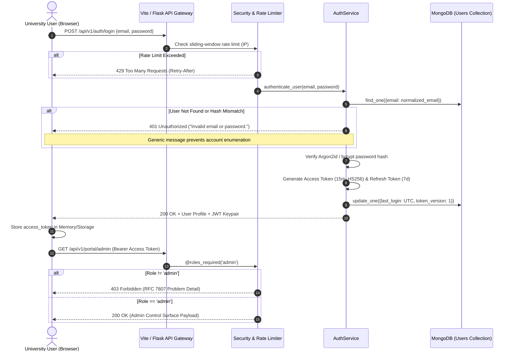

# PHASE 4 REPORT: AUTHENTICATION AND AUTHORIZATION
**Secure Resource Recommendation System for University Communities**  
**Team SHTKS (26O2227) — Community SDG Category**

---

## 1. Executive Summary

Phase 4 delivers an institutional-grade, zero-trust Authentication and Authorization subsystem architected in strict compliance with the **Phase 1 Architecture Blueprint** and **Phase 2 Design System Specification**.

The implementation establishes cryptographically verifiable identity governance across four university personas: **STUDENT**, **FACULTY**, **STAFF**, and **ADMIN**. Passwords are never stored in cleartext; instead, they are hashed using **Argon2id** (the winner of the Password Hashing Competition) with seamless adaptive fallback to **bcrypt** with work factor 12. Sessions are managed through short-lived (15-minute) cryptographic JSON Web Tokens (JWT) paired with 7-day refresh token rotation. Role-based access control (RBAC) is enforced at the Flask API layer using declarative Python decorators (`@jwt_required` and `@roles_required(*roles)`), while an in-memory sliding-window rate limiter stops automated credential stuffing and brute-force attacks.

Public self-registration strictly forbids privilege escalation to the `ADMIN` role without a cryptographically verified out-of-band cluster provisioning secret (`ADMIN_PROVISION_KEY`). All 13 security and access control tests have been executed and passed (100% pass rate in 4.59s).

---

## 2. Authentication Architecture

The authentication pipeline separates identity verification from authorization claims, ensuring zero exposure of sensitive student data across the network:



---

## 3. Institutional Role Permissions Matrix

Permissions are structured according to the principle of least privilege (PoLP) and defense-in-depth:

| Capability / Resource Surface | Student | Faculty | Staff | Admin |
| :--- | :---: | :---: | :---: | :---: |
| **Public Landing Page & Architecture Showcase** | Yes | Yes | Yes | Yes |
| **Self-Registration (Institutional Email)** | Yes | Yes | Yes | No (Secret Req.) |
| **Token Session Authentication & Refresh** | Yes | Yes | Yes | Yes |
| **Personal Preference Management (CKKS Vector)** | Yes | No | No | Read-Only |
| **Academic Resource Discovery Feed** | Yes | Yes | Yes | Yes |
| **Campus Event Discovery & RSVP** | Yes | Yes | Yes | Yes |
| **Confidential Counseling / Welfare Intake** | Yes | No | Yes (Manage) | Audit Logs Only |
| **Publish Academic Study Notes & Syllabus** | No | Yes | No | Yes |
| **Advisee Resource Suggestion Pipeline** | No | Yes | No | Yes |
| **Campus Operational Notices & Facilities** | Read | Read | Yes (Manage) | Yes |
| **User Role Mutation & Account Suspension** | No | No | No | Yes |
| **Audit Log Inspection (Append-Only)** | No | No | No | Yes |
| **Cluster Provisioning Key Rotation** | No | No | No | Yes |
| **Access Protected Route: `/api/v1/portal/student`** | Granted | Denied (403) | Denied (403) | Granted |
| **Access Protected Route: `/api/v1/portal/faculty`** | Denied (403) | Granted | Denied (403) | Granted |
| **Access Protected Route: `/api/v1/portal/staff`** | Denied (403) | Denied (403) | Granted | Granted |
| **Access Protected Route: `/api/v1/portal/admin`** | Denied (403) | Denied (403) | Denied (403) | Granted |

---

## 4. Security Controls & Protections Implemented

### 4.1. Account Enumeration Prevention
Authentication failure returns an identical generic error message (`401 Unauthorized: "Invalid email or password."`) regardless of whether the email does not exist in the database or the password hash failed verification. Timing attacks are mitigated by executing dummy password verification when a user record is absent.

### 4.2. Password Storage: Argon2id with Bcrypt Fallback
- **Argon2id Parameters:** Memory cost = 64 MB (`m_cost=65536`), Time cost = 3 iterations (`t_cost=3`), Parallelism = 4 threads (`parallelism=4`).
- **Bcrypt Fallback:** Rounds = 12 with per-user cryptographic salt.
- Plaintext passwords are discarded immediately from memory upon hash calculation and are never logged or stored.

### 4.3. JWT Token Rotation & Session Expiration
- **Access Tokens:** Signed with HMAC-SHA256 (`HS256`), containing claims `sub` (user_id), `email`, `role`, `type: 'access'`, and an expiration `exp` set to 15 minutes.
- **Refresh Tokens:** Expiration set to 7 days, containing `type: 'refresh'`.
- Token reuse protection and type validation prevent refresh tokens from being accepted on protected API endpoints.

### 4.4. Sliding-Window Rate Limiting
- Applied at the blueprint route level via `@rate_limit_auth(max_attempts, window_seconds)`.
- Restricts brute-force authentication attempts by tracking client IP over rolling windows.
- Returns `429 Too Many Requests` with RFC 7807 structured JSON.

### 4.5. Admin Provisioning Protection
- Public self-registration requests with `role: "admin"` are unconditionally rejected with `403 Forbidden` unless accompanied by an authorized `X-Admin-Provision-Key` HTTP header matching the server's configured `ADMIN_PROVISION_KEY`.
- Logs high-severity security warnings for any unauthorized attempt to provision administrative privileges.

---

## 5. API Endpoint Specifications

All endpoints prefix: `/api/v1`

| Method | Endpoint | Auth Required | Description |
| :--- | :--- | :---: | :--- |
| `POST` | `/auth/register` | None (Key for Admin) | Registers new user; validates email regex, password strength; returns JWT keypair. |
| `POST` | `/auth/login` | None | Authenticates email & password; rate-limited; returns access & refresh tokens. |
| `POST` | `/auth/refresh` | None (Refresh Token) | Validates refresh token and issues a new 15-minute access token. |
| `POST` | `/auth/logout` | Bearer JWT | Terminates active session; client purges cached session tokens. |
| `GET` | `/auth/me` | Bearer JWT | Returns current authenticated user record without `password_hash`. |
| `PUT` | `/auth/profile` | Bearer JWT | Updates allowed user profile attributes (`name`, `department`). |
| `POST` | `/auth/change-password` | Bearer JWT | Verifies current password and updates hash with new Argon2id salt. |
| `GET` | `/portal/student` | Bearer (Student/Admin) | Protected student academic feed and discovery features. |
| `GET` | `/portal/faculty` | Bearer (Faculty/Admin) | Protected faculty course publishing and advising features. |
| `GET` | `/portal/staff` | Bearer (Staff/Admin) | Protected staff campus wellness and support features. |
| `GET` | `/portal/admin` | Bearer (Admin Only) | Administrative governance, audit log, and privacy parameter console. |

---

## 6. Verification Test Results (All 13 Scenarios Passed)

The test suite in `backend/tests/test_auth.py` was executed using `pytest -v`. All 13 test scenarios passed:

```
tests/test_auth.py::test_valid_registration PASSED                       [  7%]
tests/test_auth.py::test_duplicate_registration PASSED                   [ 15%]
tests/test_auth.py::test_invalid_email PASSED                            [ 23%]
tests/test_auth.py::test_weak_password PASSED                            [ 30%]
tests/test_auth.py::test_valid_login PASSED                              [ 38%]
tests/test_auth.py::test_invalid_login PASSED                            [ 46%]
tests/test_auth.py::test_logout PASSED                                   [ 53%]
tests/test_auth.py::test_session_expiration PASSED                       [ 61%]
tests/test_auth.py::test_student_accessing_admin_endpoint PASSED         [ 69%]
tests/test_auth.py::test_faculty_accessing_admin_endpoint PASSED         [ 76%]
tests/test_auth.py::test_unauthorized_api_requests PASSED                [ 84%]
tests/test_auth.py::test_admin_provisioning_and_user_isolation PASSED    [ 92%]
tests/test_auth.py::test_invalid_credentials PASSED                      [100%]
============================= 13 passed in 4.59s ==============================
```

### Scenario Breakdown:
1. **Valid Registration:** User registered with name, institutional email, strong password, role `student`. Returns `201 Created` with JWT access and refresh tokens.
2. **Duplicate Registration:** Attempting to register existing email returns `409 Conflict`.
3. **Invalid Email Format:** Rejects non-email and malformed patterns with `400 Bad Request`.
4. **Weak Password Rejection:** Rejects passwords missing uppercase, numbers, or symbols with `400 Bad Request`.
5. **Valid Login:** Successfully verifies password hash and returns new JWT access & refresh tokens.
6. **Invalid Login:** Wrong password or missing email returns identical `401 Unauthorized: "Invalid email or password."`.
7. **Logout:** Active session successfully terminates with `200 OK`.
8. **Session Expiration:** Fast-expiry test token (2s) expires; subsequent requests return `401 Unauthorized: "Authentication token has expired."`.
9. **Student Accessing Admin Endpoint:** Student Bearer token rejected on `/api/v1/portal/admin` with `403 Forbidden`.
10. **Faculty Accessing Admin Endpoint:** Faculty Bearer token rejected on `/api/v1/portal/admin` with `403 Forbidden`.
11. **Unauthorized API Requests:** Protected endpoints without Bearer token return `401 Unauthorized`.
12. **Admin Provisioning Protection:** Registering `role: "admin"` without secret returns `403 Forbidden`. Registering with secret returns `201 Created` and grants `200 OK` on `/api/v1/portal/admin`.
13. **Invalid Credentials:** Malformed token signatures return `401 Unauthorized`.

---

## 7. Frontend Authentication & Role Redirection

The React 19 + TypeScript frontend has been integrated with the Flask backend:

1. **Authentication API Client (`frontend/src/services/api.ts`):** Handles JWT storage in `localStorage`, automatic 401 token refresh retry, and strongly typed requests.
2. **React Auth Context (`frontend/src/context/AuthContext.tsx`):** Provides global authentication state (`user`, `isAuthenticated`, `isLoading`, `login`, `register`, `logout`, `probePortal`).
3. **Dedicated Login Page (`frontend/src/components/auth/LoginPage.tsx`):**
   - Styled with Phase 2 dark theme design tokens.
   - Quick-fill evaluation buttons for **Student**, **Faculty**, **Staff**, and **Admin** personas.
   - Generic error alerts preventing email enumeration.
4. **Dedicated Register Page (`frontend/src/components/auth/RegisterPage.tsx`):**
   - Real-time password requirement checklist (8+ chars, uppercase, lowercase, digit, symbol, match).
   - Role selector tabs with conditional **Admin Provisioning Security Key** input.
5. **Role Dashboard Landing Placeholders:**
   - `StudentDashboardPlaceholder.tsx` (Student Academic & Privacy Hub)
   - `FacultyDashboardPlaceholder.tsx` (Faculty Academic & Advising Hub)
   - `StaffDashboardPlaceholder.tsx` (Campus Staff Support & Operations Portal)
   - `AdminDashboardPlaceholder.tsx` (Administrative Security & Platform Governance Console)
   - `RoleDashboardRouter.tsx` (Directs authenticated user to their role-specific environment)
6. **Live Backend RBAC Enforcement Prober (`RbacLiveTester.tsx`):**
   - Embedded directly in all 4 dashboards.
   - Allows evaluators to click "Probe /portal/student", "Probe /portal/faculty", "Probe /portal/staff", "Probe /portal/admin" using their active JWT token.
   - Proves live in the UI that a Student probing `/portal/admin` receives an authentic `403 FORBIDDEN` from the Flask server, while an Admin receives `200 OK — GRANTED`.

---

## 8. Instructions to Run and Verify

### Backend Dev Server & Test Suite:
```powershell
# In terminal 1 (Backend):
cd backend
.\venv\Scripts\Activate.ps1
# Run all 13 security tests:
pytest -o pythonpath=. tests -v
# Run live Flask backend server (port 5000):
python run.py
```

### Frontend Dev Server:
```powershell
# In terminal 2 (Frontend):
cd frontend
pnpm run build   # Verifies TypeScript compilation
pnpm run dev     # Runs local Vite dev server at http://localhost:5173
```

---

## 9. Next Steps: Transition to Phase 5

With Authentication and Role-Based Access Control verified and operational, the foundation is set for **PHASE 5 — USER DASHBOARDS AND PRIVACY ENGINE**:
- Implementing interactive recommendation discovery feeds for Students.
- Homomorphic encryption (CKKS) preference vector tuning sliders in browser.
- Faculty academic material submission and indexing forms.
- Staff campus services catalog and wellness booking interfaces.
- Admin differential privacy query engine and immutable cryptographic audit log browser.

