# PHASE 5 REPORT: STUDENT DASHBOARD ARCHITECTURE & IMPLEMENTATION
**Secure Resource Recommendation System for University Communities**  
**Team SHTKS (26O2227) — Community SDG Category**

---

## 1. Executive Summary

Phase 5 delivers a complete, production-grade **Student Dashboard** designed and implemented in strict alignment with the **Phase 1 Architecture Blueprint**, **Phase 2 Design System Specification**, **Phase 3 Cinematic Landing Experience**, and **Phase 4 Authentication Subsystem**.

The student experience combines academic resource discovery, campus events scheduling, confidential university services cataloging, baseline personalized recommendations, a persistent bookmarking stash, interaction history, and an educational, interactive Privacy Center. Every component is directly integrated with backend Flask REST endpoints and MongoDB storage, while strictly respecting privacy guarantees and institutional boundaries.

In accordance with strict integrity guidelines, recommendations are clearly identified as computed via a **Transparent Baseline Content Heuristic (v1.0)** (departmental affinity, peer engagement, and curriculum alignment) rather than fabricated AI claims, establishing an authentic foundation for the TensorFlow 2.x and CKKS Homomorphic Encryption models planned for Phase 6.

All 22 automated security and dashboard API tests pass with a 100% success rate in 5.61 seconds.

---

## 2. Dashboard Information Architecture & Navigation

The dashboard navigation architecture features a collapsible, responsive sidebar with active route states, badge counts, and role-aware navigation:

```mermaid
graph TD
    User([Authenticated Student]) --> Dashboard[Student Dashboard Container]
    
    Dashboard --> Nav[Collapsible Sidebar Navigation]
    Dashboard --> Header[Top Application Bar]
    
    Nav --> View1[1. Overview: Metrics, Feed Preview, Recent Stash]
    Nav --> View2[2. Discover Resources: Search, Categories, Modals]
    Nav --> View3[3. University Events: On-Campus vs Virtual, RSVP]
    Nav --> View4[4. University Services: Confidentiality Tiers, Hours]
    Nav --> View5[5. My Recommendations: Baseline Engine, Feedback]
    Nav --> View6[6. Saved Items: Bookmarked Academic Stash]
    Nav --> View7[7. Recommendation History: Interaction Audit Trail]
    Nav --> View8[8. Privacy Center: Noise Sliders, Data Inventory]
    Nav --> View9[9. My Profile: Department Affiliation, ID]
    Nav --> View10[10. Settings: Argon2id Password Rotation, Alerts]
    
    Header --> QuickRec[Quick Recommendations CTA]
    Header --> StashCounter[Live Stash Counter]
    Header --> ReturnLanding[Return to Landing Page]
    Header --> CKKSStatus[CKKS 128-bit Zero Cleartext Status]
```



---

## 3. Detailed Views & Capabilities

### 3.1. Overview View (`OverviewView.tsx`)
- **Personalized Hero Greeting**: Welcomes the student using verified profile claims (`name`, `department`), reinforcing their accredited status.
- **Key Metric Indicators**:
  - **Saved Stash Count**: Dynamic count of personal bookmarks stored in MongoDB.
  - **Active Recommendations**: Live count of calibrated baseline suggestions.
  - **Upcoming Campus Events**: Next scheduled university hackathons, workshops, and lectures.
  - **Privacy Tier Status**: Confirms Argon2id salted credentials, 15m JWT sessions, and zero cleartext vector storage.
- **Quick Action Shortcuts**: Instant access to Discover Resources, Campus Events, Support Services, and Privacy Center.
- **Curated Recommendations & Events Preview**: Top 3 affinity-matched resources and next 3 chronological campus events with inline bookmark toggles.
- **Recent Activity Ledger**: Real-time audit of recent bookmarks and recommendation ratings.

### 3.2. Resource Discovery Catalog (`ResourcesView.tsx`)
- **Category Filter Tabs**: All Resources, Study Materials, Research Papers, Fellowships & Grants, Learning Guides, Tutorials & Code, Tutoring & Support.
- **Department Selector**: Filter by Computer Science, Mathematics, Electrical Engineering, Interdisciplinary.
- **Live Search**: Multi-field regex search matching titles, descriptions, author names, and topic tags.
- **Sort Options**: Newest First, Most Bookmarked, Highest Rated, Alphabetical.
- **Resource Detail Inspection Modal**: Full metadata inspection drawer displaying source URL, author/faculty affiliation, format (PDF, Jupyter Notebook, Interactive Reference), peer rating, and direct bookmark controls.

### 3.3. University Events Discovery (`EventsView.tsx`)
- **Categorization**: Hackathons, Guest Academic Lectures, Workshops, Career Expos, Departmental Colloquia.
- **Virtual vs. On-Campus Filters**: Clear visual distinction between physical venues (e.g. *Turing Center for Computational Innovation*) and Virtual Zoom streams.
- **Registration Safeguards**: Displays RSVP requirements and application deadlines.
- **Direct Bookmarking**: Add/remove events to student stash with live feedback.

### 3.4. University Services Discovery (`ServicesView.tsx`)
- **Categorization**: Student Support, Academic Support, Library Services, Technical Support, Career Guidance.
- **Confidentiality Tiers**: Clearly distinguishes **High (Zero-Knowledge Intake)** services (e.g. *Confidential Psychological Counseling & Crisis Support*) from standard FERPA-regulated academic services.
- **Operating Coordinates**: Location, hours of operation, and official departmental contact email.

### 3.5. Personalized Recommendations (`RecommendationsView.tsx`)
- **Transparent Model Disclosure Banner**: Prominently informs students that recommendations currently operate on a **Baseline Content Heuristic v1.0** (department matching, keyword overlap, community engagement), preparing the client memory for Phase 6 CKKS homomorphic vector scoring.
- **Explainability**: Every recommendation includes a human-readable explanation (`[Baseline Heuristic] Department affinity (Computer Science) & Highly rated by peers (4.9 / 5.0)`).
- **Interactive Feedback Mechanism**:
  - `Useful` (Thumbs Up): Calibrates positive affinity.
  - `Irrelevant` (Thumbs Down): Penalizes topic weight in baseline matching.
  - `Save`: Adds item directly to personal stash.
- **Real-Time Backend Synchronization**: Every feedback click dispatches a POST request to `/api/v1/recommendations/feedback` and logs to `/api/v1/recommendations/history`.

### 3.6. Saved Academic Stash (`SavedItemsView.tsx`)
- **Persistent Personal Library**: Consolidated view of all bookmarked resources, events, and services.
- **Filter by Type**: All, Resources, Events, Services.
- **One-Click Unsave**: Instant removal via backend API.
- **Empty State**: Friendly CTA linking directly to Resource Discovery when the stash is empty.

### 3.7. Recommendation History (`HistoryView.tsx`)
- **Audit Trail**: Displays past recommendation interactions with timestamps, item titles, categories, and recorded verdicts (`useful`, `not_relevant`, `saved`).
- **Data Integrity**: Allows students to review what explicit feedback has been recorded for recommendation calibration.

### 3.8. Privacy Center (`PrivacyView.tsx`)
- **Data Storage Inventory**: Transparent side-by-side audit of what data is stored on university servers (email, Argon2id hash, department, consent log) versus what is never stored in cleartext (cleartext passwords, raw preference vectors, confidential counseling intake).
- **Data Sharing Toggles**:
  - Department Affiliation Sharing.
  - Interaction & Feedback History Collection.
  - Anonymize Saved Collection Bookmarks.
- **Advanced Cryptographic Parameters**:
  - **CKKS Homomorphic Noise Scale Slider** (`0.01` to `0.20`): Calibrates client-side Gaussian perturbation scale.
  - **Differential Privacy Epsilon Slider** (`0.1` to `1.5`): Adjusts mathematical privacy budget.
- **Consent Handshake**: Records timestamp of consent updates in MongoDB.

### 3.9. Student Profile & Settings (`ProfileView.tsx`, `SettingsView.tsx`)
- **Profile Management**: Update full legal name and primary academic department affiliation.
- **Argon2id Password Rotation**: Changes password with mandatory verification of current password, applying new cryptographic salts and enforcing institutional complexity rules.
- **Session Governance**: Terminate active session and purge tokens from memory.

---

## 4. Backend Architecture & MongoDB Schema Integration

The backend was extended with modular blueprints, automated seeder, and MongoDB collections:

### 4.1. New Collections & Indexes
1. `resources`: Indexed on `category`, `department`, `created_at`.
2. `events`: Indexed on `date`, `category`.
3. `services`: Indexed on `category`, `is_active`.
4. `bookmarks`: Unique compound index on `(user_id, item_id)` preventing duplicate saves.
5. `recommendation_feedback`: Compound index on `(user_id, timestamp)` for rapid history queries.
6. `privacy_preferences`: Indexed on `user_id` with default privacy parameters.

### 4.2. API Endpoints Implemented

| Method | Endpoint | Auth Required | Description |
| :--- | :--- | :---: | :--- |
| `GET` | `/api/v1/resources` | No | Filtered & sorted academic resources catalog. |
| `GET` | `/api/v1/resources/<id>` | No | Single resource detail record. |
| `GET` | `/api/v1/events` | No | Campus events with category & virtual filters. |
| `GET` | `/api/v1/services` | No | University services catalog with confidentiality tiers. |
| `GET` | `/api/v1/recommendations/student` | Bearer (Student) | Baseline personalized recommendations with explanations. |
| `POST` | `/api/v1/recommendations/feedback` | Bearer (Student) | Submit `useful` / `not_relevant` / `saved` feedback. |
| `GET` | `/api/v1/recommendations/history` | Bearer (Student) | Retrieve user's recommendation interaction history. |
| `GET` | `/api/v1/bookmarks` | Bearer JWT | Retrieve user's saved items across all types. |
| `POST` | `/api/v1/bookmarks` | Bearer JWT | Toggle bookmark (adds or removes with save count adjustment). |
| `DELETE` | `/api/v1/bookmarks/<id>` | Bearer JWT | Remove specific item from bookmarks. |
| `GET` | `/api/v1/privacy/preferences` | Bearer JWT | Retrieve user privacy settings & noise parameters. |
| `PUT` | `/api/v1/privacy/preferences` | Bearer JWT | Update privacy preferences and log consent timestamp. |

---

## 5. Automated Verification Test Suite (22 Passed)

All 22 automated tests were executed via Pytest:

```
tests/test_auth.py::test_valid_registration PASSED                       [  4%]
tests/test_auth.py::test_duplicate_registration PASSED                   [  9%]
tests/test_auth.py::test_invalid_email PASSED                            [ 13%]
tests/test_auth.py::test_weak_password PASSED                            [ 18%]
tests/test_auth.py::test_valid_login PASSED                              [ 22%]
tests/test_auth.py::test_invalid_login PASSED                            [ 27%]
tests/test_auth.py::test_logout PASSED                                   [ 31%]
tests/test_auth.py::test_session_expiration PASSED                       [ 36%]
tests/test_auth.py::test_student_accessing_admin_endpoint PASSED         [ 40%]
tests/test_auth.py::test_faculty_accessing_admin_endpoint PASSED         [ 45%]
tests/test_auth.py::test_unauthorized_api_requests PASSED                [ 50%]
tests/test_auth.py::test_admin_provisioning_and_user_isolation PASSED    [ 54%]
tests/test_auth.py::test_invalid_credentials PASSED                      [ 59%]
tests/test_student_dashboard_api.py::test_get_resources PASSED           [ 63%]
tests/test_student_dashboard_api.py::test_filter_resources_by_category_and_search PASSED [ 68%]
tests/test_student_dashboard_api.py::test_resource_detail_and_404 PASSED [ 72%]
tests/test_student_dashboard_api.py::test_get_events PASSED              [ 77%]
tests/test_student_dashboard_api.py::test_get_services PASSED            [ 81%]
tests/test_student_dashboard_api.py::test_student_recommendations_baseline PASSED [ 86%]
tests/test_student_dashboard_api.py::test_recommendation_feedback_and_history PASSED [ 90%]
tests/test_student_dashboard_api.py::test_toggle_bookmark PASSED         [ 95%]
tests/test_student_dashboard_api.py::test_privacy_preferences_flow PASSED [100%]
============================= 22 passed in 5.61s ==============================
```

---

## 6. Files Created or Modified

### Backend:
- `backend/app/core/seeder.py`: Initial authentic catalog seeding for resources, events, services.
- `backend/app/core/database.py`: Automatic seeding and index creation for bookmarks and feedback collections.
- `backend/app/api/resources.py`: REST blueprint for resources catalog.
- `backend/app/api/events.py`: REST blueprint for events catalog.
- `backend/app/api/services.py`: REST blueprint for services catalog.
- `backend/app/api/bookmarks.py`: REST blueprint for bookmarking and personal stash management.
- `backend/app/api/recommendations.py`: REST blueprint for baseline recommendation scoring, feedback, and history.
- `backend/app/api/privacy.py`: REST blueprint for privacy settings and noise parameter calibration.
- `backend/app/__init__.py`: Registered all 6 new blueprints in Flask app factory.
- `backend/tests/test_student_dashboard_api.py`: Automated Pytest suite covering all student API capabilities.
- `backend/tests/conftest.py`: Fixture management preserving catalog seeds across test cases.

### Frontend:
- `frontend/src/services/studentApi.ts`: Strongly typed API client for resources, events, services, recommendations, bookmarks, and privacy.
- `frontend/src/components/dashboards/student/StudentSidebar.tsx`: Navigation sidebar with collapsible state and active indicator.
- `frontend/src/components/dashboards/student/StudentHeader.tsx`: Top application bar with breadcrumbs, CKKS status, and stash counter.
- `frontend/src/components/dashboards/student/StudentDashboard.tsx`: Master student dashboard orchestrator with toast notification system and bookmark synchronization.
- `frontend/src/components/dashboards/student/views/OverviewView.tsx`: Dashboard overview with greeting, metrics, previews, and quick actions.
- `frontend/src/components/dashboards/student/views/ResourcesView.tsx`: Resource discovery catalog with category filters, search, and detail modal.
- `frontend/src/components/dashboards/student/views/EventsView.tsx`: University events listing with on-campus vs virtual filtering.
- `frontend/src/components/dashboards/student/views/ServicesView.tsx`: Campus services catalog with confidentiality tiers.
- `frontend/src/components/dashboards/student/views/RecommendationsView.tsx`: Baseline recommendation feed with explainability and feedback controls.
- `frontend/src/components/dashboards/student/views/SavedItemsView.tsx`: Bookmarked items management stash.
- `frontend/src/components/dashboards/student/views/HistoryView.tsx`: Recommendation interaction timeline audit log.
- `frontend/src/components/dashboards/student/views/PrivacyView.tsx`: Privacy center with data inventory and noise sliders.
- `frontend/src/components/dashboards/student/views/ProfileView.tsx`: Student profile and department editor.
- `frontend/src/components/dashboards/student/views/SettingsView.tsx`: Password rotation and communication settings.
- `frontend/src/components/dashboards/RoleDashboardRouter.tsx`: Updated router directing student accounts directly to `StudentDashboard`.

---

## 7. Instructions to Run and Inspect

### Backend:
```powershell
cd backend
.\venv\Scripts\Activate.ps1
# Run full 22-test automated test suite:
pytest -o pythonpath=. tests -v
# Run live Flask backend (port 5000):
python run.py
```

### Frontend:
```powershell
cd frontend
# Verify production build:
pnpm run build
# Start local Vite development server (port 5173):
pnpm run dev
```

---

## 8. Next Phase Roadmap (Phase 6: Privacy Engine & Machine Learning)

With the complete student dashboard operational and verified, the next phase focuses on:
- Replacing the baseline recommendation heuristic with **TensorFlow 2.x collaborative filtering**.
- Integrating client-side **CKKS Homomorphic Encryption** vector encoding using TenSEAL / Pyfhel in Python and WebAssembly in browser.
- Multi-party computation (MPC) protocols for oblivious dot-product score calculation across encrypted server matrices.

